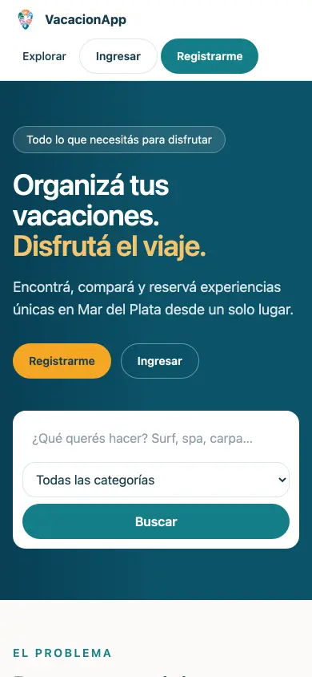
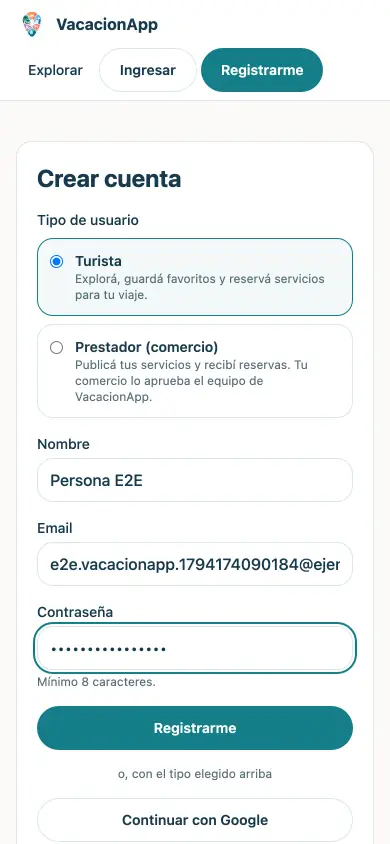
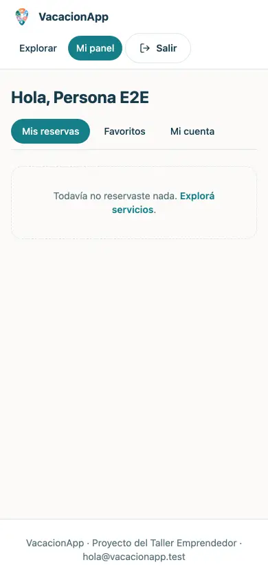
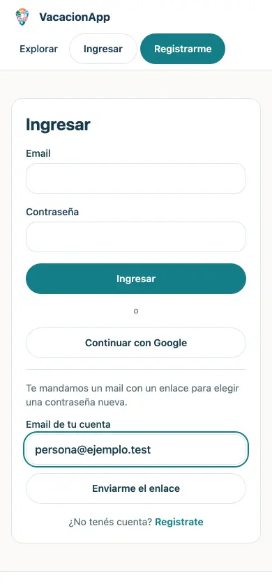
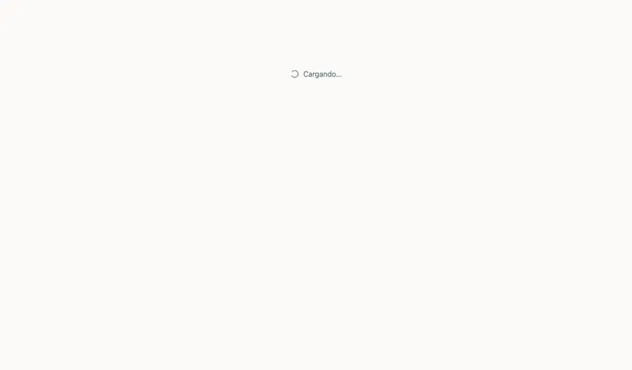
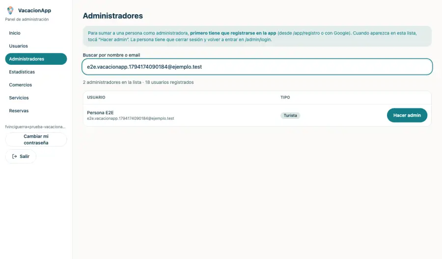
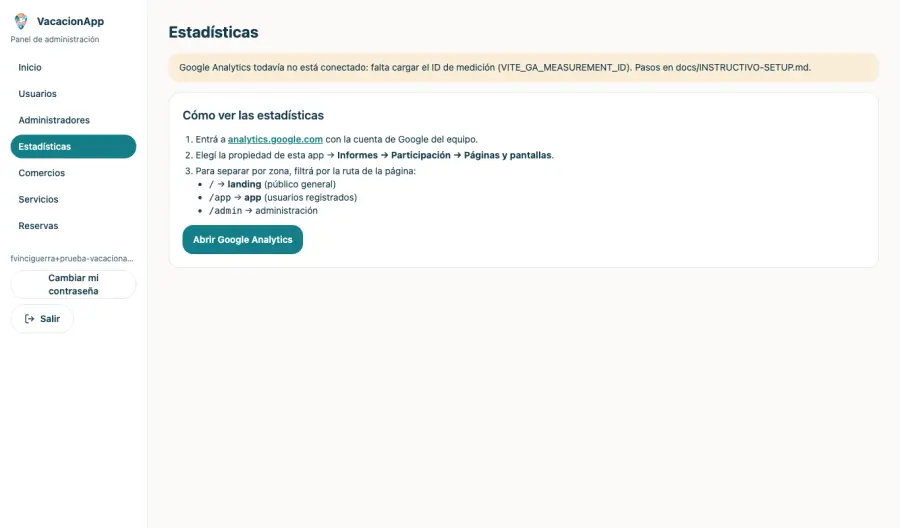

# Prueba E2E en producción — VacacionApp

Probado el **2026-11-08** en https://vacacionapp-mdp-d7e72.web.app con un navegador real (Chromium), en celular (390 px) y escritorio. Se usó una cuenta de prueba de admin y un usuario nuevo registrado para la prueba (**ya borrado**).

## Resultado

| Flujo | Qué se comprobó |
|---|---|
| ✅ landing móvil | carga y muestra el título |
| ✅ olvidé mi contraseña | el formulario aparece |
| ✅ registro | usuario nuevo llega a /app/turista |
| ✅ sesión persistente | tras recargar sigue dentro |
| ✅ landing escritorio | carga |
| ✅ login admin | cuenta de prueba entra a /admin |
| ✅ administradores | el usuario recién registrado aparece con "Hacer admin" |
| ✅ estadísticas | la sección carga |
| ✅ usuarios | lista cargada |

Además, en cada cambio corre una **suite automática** (GitHub Actions, `npm test`) con los flujos propios de VacacionApp (reservas, favoritos y comercios), las reglas de seguridad y estos mismos pasos contra emuladores de Firebase.

**No se probó** (limitaciones): el login con Google en producción por esta vía automática; el envío real de mails ("Olvidé mi contraseña" se probó hasta el formulario; hay que confirmar la recepción con una cuenta propia).

## Capturas

**Landing en el celular**

**Registro (Google o email y contraseña, con elección de tipo)**

**Panel del usuario nuevo (sesión persistente)**

**"Olvidé mi contraseña"**

**Panel de administración (solo con login)**

**Administradores: dar rol de admin a quien ya se registró**

**Estadísticas (Google Analytics)**

